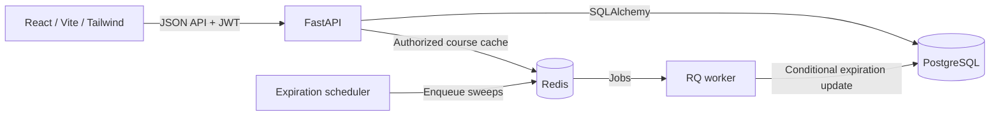

# Multi-Tenant Learning Platform

A working learning platform for institutes. Each institute has its own administrators, learners, courses, assignments, and progress. Five roles are enforced by the API, with tenant isolation backed by scoped queries and database constraints.

## What it does

- Platform staff create institutes and their sole Tenant Admin. Multiple platform Super Admins are allowed. There is no public signup; Tenant Admins create learner accounts and can transfer their role to one active learner.
- Tenant Admins manage people and courses, add multiple-choice or text questions to lessons, enroll learners from a course, and view their answers and progress. They can deactivate/reactivate users and archive/restore courses without deleting saved progress.
- Learners read enrolled courses and answer questions inside each lesson. Correct multiple-choice answers and submitted text answers complete a question-based lesson; progress survives sign-out and reloads.
- A new institute receives a 14-day trial by default. Expiration blocks learning access while preserving accounts and data; a Super Admin can reactivate it.
- The same email can identify separate accounts in different institutes. Sign-in searches institutes by name and sends the selected slug to the login API; an exact slug can still be entered directly.

## Architecture



PostgreSQL is the source of truth. FastAPI validates JWTs, reloads the current account, checks its role and tenant status, and derives tenant scope from that account rather than request-supplied IDs. Related records use composite foreign keys to prevent cross-tenant assignments and progress. Course cache keys include tenant and content version; authorization runs before cache access. A request checks its tenant's trial deadline even if the background scheduler or worker is delayed. Alembic owns schema migrations, and Pydantic validates API data. See [architecture and design decisions](docs/architecture.md) and [backend API details](backend/README.md).

## Start the app locally

Install Python 3.12–3.14, [uv](https://docs.astral.sh/uv/), Node.js/npm compatible with Vite 8, and Docker Desktop. On Windows, **open Docker Desktop and wait for its Linux engine to start** before running Compose. The commands below use PowerShell; use `npm` instead of `npm.cmd` on macOS/Linux.

### First-time setup

From the **repository root** (the folder containing `compose.yaml`):

```powershell
docker compose up -d --wait
cd backend
uv sync --locked
uv run python scripts/init_env.py
uv run alembic upgrade head
uv run python -m app.bootstrap --demo
cd ..\frontend
npm.cmd ci
```

`init_env.py` creates a private `backend/.env` with a random JWT secret. The optional `--demo` step creates the accounts below and only accepts a loopback database. Rerunning it preserves demo passwords, trial deadlines, and progress. For a private initial Super Admin instead, skip `--demo` and, from `backend/`, run `uv run python -m app.bootstrap --email your-admin@example.com`; enter a password when prompted.
After updating an existing checkout, run `uv run alembic upgrade head` from `backend/` before starting the API. The current migrations add lesson-question tables and the one-Tenant-Admin-per-institute index. If an older database has multiple Tenant Admins or no active Tenant Admin in an institute, resolve that account state before migrating; the migration stops rather than changing privileges silently.

### Every time you run the app

Run `docker compose up -d --wait` once from the **repository root**. It exits after PostgreSQL and Redis are healthy, so that terminal can be reused. Then keep **three terminals** open, each starting from the repository root.

**Terminal 1 — API:**

```powershell
cd backend
uv run uvicorn app.main:create_app --factory --reload --host 127.0.0.1 --port 8000
```

**Terminal 2 — worker and expiration scheduler together:**

```powershell
cd backend
uv run python -m app.background
```

**Terminal 3 — frontend:**

```powershell
cd frontend
npm.cmd run dev
```

Open <http://localhost:5173> and sign in with a demo account below. API documentation is at <http://127.0.0.1:8000/docs>; check <http://127.0.0.1:8000/api/v1/health/ready> if the frontend cannot reach the API. Vite proxies `/api` to FastAPI. Compose binds PostgreSQL to `127.0.0.1:5433` and Redis to `127.0.0.1:6379`; their data persists in Docker volumes.

Run all `uv run` API/background commands **inside `backend/`**, since the Python `app` package lives there. If Compose reports a missing `dockerDesktopLinuxEngine` pipe, start Docker Desktop and retry. Stop the three running processes with `Ctrl+C`; from the repository root, `docker compose stop` stops PostgreSQL and Redis without removing their data.

## Demo sign-in and workflow

All demo accounts use password **`LocalDemo-learning-2026!`**. The development-only sign-in panel can fill these credentials. Choose **Platform account** for platform roles; choose **Institute account**, search by name, and select a suggestion for institute accounts. You can also enter the corresponding slug directly.

| Account | Role | Institute slug |
| --- | --- | --- |
| `superadmin@example.com` | Super Admin | Platform sign-in |
| `admin@example.com` | Admin | Platform sign-in |
| `viewer@example.com` | Super Viewer | Platform sign-in |
| `river.admin@example.com` | Tenant Admin | `river-institute` |
| `river.learner@example.com` | Tenant User | `river-institute` |
| `summit.admin@example.com` | Tenant Admin | `summit-institute` |
| `summit.learner@example.com` | Tenant User | `summit-institute` |

To explore the full flow: a Super Admin creates an institute and its initial Tenant Admin; that admin creates learners, a course, lessons, and optional lesson questions, then searches and selects **up to 50 learners at once** from the course page. Enrollment is atomic: if one selected account is invalid or already enrolled, no new enrollments are created. Each learner signs in, reads lessons, answers questions, and records progress; the admin sees answers and progress. A Super Admin can expire and reactivate the institute without deleting its data. Demo accounts are for local development only.

| Role | Main permissions |
| --- | --- |
| Super Admin | Create/rename institutes, expire/reactivate trials, create platform accounts, read platform metadata |
| Admin | Create/rename institutes and read platform accounts; cannot change trial status |
| Super Viewer | Read-only platform metadata |
| Tenant Admin | Manage users, courses, lessons, and lesson questions within their institute; enroll learners, review submitted answers and progress, deactivate/reactivate learners, transfer their sole admin role to an active learner, and archive/restore courses |
| Tenant User | Read enrolled courses, answer lesson questions, and record their own progress |

Platform roles do not access tenant learning endpoints. Backend permissions remain authoritative even when a UI control is hidden. Full route and role details are in [backend/README.md](backend/README.md); frontend behavior is in [frontend/README.md](frontend/README.md).

## Tests and quality checks

From `backend/`:

```powershell
uv run pytest -q
uv run ruff check .
uv run ruff format --check .
```

For PostgreSQL constraint, concurrency, migration, cache, and queue tests, set `TEST_DATABASE_URL` and `REDIS_TEST_URL` as shown in [backend/README.md](backend/README.md). Tests create isolated schemas and keys.

From `frontend/`:

```powershell
npm.cmd test
npm.cmd run lint
npm.cmd run format:check
npm.cmd run build
npx.cmd playwright install chromium --only-shell
npm.cmd run test:e2e
```

Browser tests need PostgreSQL, Redis, and the backend virtual environment. They start isolated test servers on ports 8001 and 4173. The repository includes backend and frontend CI workflow definitions under `.github/workflows/`.

## Repository map

| Path | Purpose |
| --- | --- |
| `backend/app/` | API, authorization, models, services, worker, scheduler |
| `backend/alembic/` | Versioned database migrations |
| `backend/tests/` | API, security, isolation, lifecycle, and infrastructure tests |
| `frontend/src/` | React application, components, styles, and API client |
| `frontend/e2e/` | Browser workflows with isolated test data |
| `compose.yaml` | Local PostgreSQL and Redis |
| `docs/architecture.md` | Implemented architecture, request path, and tradeoffs |
| [`docs/How I used AI.md`](<docs/How I used AI.md>) | How AI assistance and project context were used |
| [`AI Course Design.md`](<AI Course Design.md>) | AI course-generation design draft for contributor completion |
| `AGENTS.md` | Contributor and AI coding instructions |
| [`prompts.md`](prompts.md) | Selected excerpts of project instructions supplied to the assistant |
| [`skills/review-tenant-boundaries/`](skills/review-tenant-boundaries/) | Repository-specific implementation review skill |

## Submission notes

| Required item | Location |
| --- | --- |
| Tests | [`backend/tests/`](backend/tests/), [`frontend/src/lib/api.test.js`](frontend/src/lib/api.test.js), [`frontend/e2e/`](frontend/e2e/) |
| Database schema and migrations | [`backend/app/models/`](backend/app/models/), [`backend/alembic/versions/`](backend/alembic/versions/) |
| Setup and run instructions | This README; [`backend/README.md`](backend/README.md) and [`frontend/README.md`](frontend/README.md) add details |
| Short architecture documentation | [`docs/architecture.md`](docs/architecture.md) |
| AI course-generation design | [`AI Course Design.md`](<AI Course Design.md>) — contributor draft requiring completion |
| Demo credentials | [Demo sign-in and workflow](#demo-sign-in-and-workflow) |

| Time record | Contributor-provided value |
| --- | --- |
| Estimated effort | 15 hours |
| Actual effort | Approximately 8–9 effective hours, including reading, analysis, AI course design, and corrections |
| Self-deadline | Sunday, October 4, 2026, 10:00 AM (Asia/Katmandu) |

The take-home brief explicitly prohibits AI-written **AI course-generation design documentation**. The [AI Course Design](<AI Course Design.md>) draft should be completed by the contributor before submission. This is a design-only requirement; there is no AI course-generation command or API to run. The app and verification commands are above. The submission repository is [Pranaya-sht/Multi_Tenant_Learning_Platform](https://github.com/Pranaya-sht/Multi_Tenant_Learning_Platform). The implementation does not include payments, public signup, email invitations, token refresh, or password recovery.
